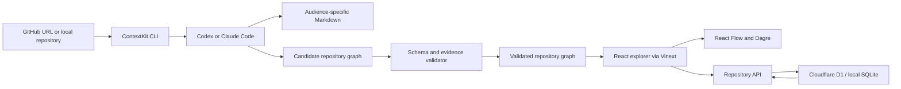

# ContextKit

Generate evidence-backed repository context packs and interactive architecture graphs for humans and AI agents.


## Why ContextKit?

Understanding an unfamiliar repository means piecing together information from source files, tests, configuration, scripts, CI workflows, and documentation. ContextKit turns that scattered knowledge into a structured context pack for onboarding, review, contribution, interview preparation, and AI-assisted development.

Unlike a generic repository summary, ContextKit produces audience-specific documents and a validated graph whose observed architecture claims cite repository-relative evidence paths.

## Architecture



The Bash CLI handles source resolution, temporary cloning, agent invocation, output selection, and file publishing. Codex or Claude Code inspects the target repository in read-only mode. Graphs are validated against the source repository before publication. The optional React explorer runs through Vinext, validates imported graph structure, stores documents through a Cloudflare D1 binding, and renders them with React Flow and Dagre.

## Quick Start

Requirements:

- Git and a Bash-compatible shell
- Codex CLI installed and authenticated, or Claude Code, for Markdown/Atlas
  generation and optional semantic network analysis
- Node.js `>=22.13.0` for graph validation, network generation, and the web interface
- Python 3 for Python symbol/call extraction (optional for other repositories)

Install the CLI:

```bash
git clone https://github.com/nk-droid/contextkit.git
cd contextkit
make install
export PATH="$PWD/bin:$PATH"
```

Generate a complete context pack:

```bash
contextkit generate https://github.com/owner/repository --all --with-graph
```

By default, output goes to `./context-packs/<repo-slug>/` relative to the directory where you run the command.

Start the graph explorer:

```bash
make web-install
make web-dev
```

Open the local URL printed by the development server and import the generated `REPO_GRAPH.json` file.

## Example

Generate all documents and a repository graph with Codex:

```bash
contextkit generate https://github.com/owner/repository \
  --all \
  --with-graph
```

Use Claude Code with a larger turn budget:

```bash
contextkit generate /path/to/local/repository \
  --all \
  --with-graph \
  --agent claude \
  --max-turns 30
```

Choose a separate output directory:

```bash
contextkit generate /path/to/local/repository \
  --all \
  --with-graph \
  --output /path/to/output
```

Existing files are skipped by default. Add `--regenerate` to replace the selected outputs.

`--max-turns` applies only to Claude Code; `--model` can select a model for either agent.

## Generated Context

| Audience | Output | Focus |
|---|---|---|
| Human | `HUMAN_OVERVIEW.md` | Plain-English repository orientation |
| Architecture | `ARCHITECTURE.md` | Components, boundaries, flows, and trade-offs |
| Modules | `MODULE_GUIDE.md` | Important directories, files, and responsibilities |
| Reviewer | `REVIEWER_GUIDE.md` | Risk areas, checks, and validation strategy |
| Contributor | `CONTRIBUTOR_GUIDE.md` | Setup, reading order, and common workflows |
| Agent | `AGENT_CONTEXT.md` | Concise constraints and paths for AI systems |
| Interviewer | `INTERVIEWER_BRIEF.md` | Project narrative, decisions, and talking points |

A complete generation produces:

```text
context-packs/
  repo-slug/
    INDEX.md
    HUMAN_OVERVIEW.md
    ARCHITECTURE.md
    MODULE_GUIDE.md
    REVIEWER_GUIDE.md
    CONTRIBUTOR_GUIDE.md
    AGENT_CONTEXT.md
    INTERVIEWER_BRIEF.md
    REPO_GRAPH.json
```

Without `--all`, ContextKit generates the human overview by default. Select another audience with `--audience human`, `architecture`, `modules`, `reviewer`, `contributor`, `agent`, or `interviewer`.

## Agent Skills

The same documents, graph, and component network are available as agent skills, so Claude Code, Codex, and other agents that support skills can produce them inside a session.

| Skill | Produces |
|---|---|
| `repo-context` | Any of the audience documents above, or a full pack with `INDEX.md` |
| `repo-graph` | `REPO_GRAPH.json`, checked with the bundled validator before it is written |
| `repo-network` | `NETWORK_FACTS.json` for `/network`, through this checkout's network pipeline: static, a headless provider, or the agent doing the semantic slices itself |

`repo-context` and `repo-graph` are self-contained. `repo-network` runs this checkout's commands, so it needs `npm ci --ignore-scripts` here; it finds the checkout through its install link or `CONTEXTKIT_HOME`.

The skills live in `.agents/skills/`, which Codex and most other agents read; `.claude/skills/` links to them for Claude Code. They work as-is inside this checkout. To use them on other repositories, link them into your user-level skill directories:

```bash
make install-skills   # links into ~/.claude/skills and ~/.agents/skills
```

Then ask an agent for something like "a reviewer guide for this repo", or invoke a skill directly: `/repo-context reviewer` in Claude Code, `$repo-context` in Codex. Output goes to `~/context-packs/<repo-name>/` unless you name a directory.

The CLI reads the same files. `contextkit generate` sends `repo-context/references/standards.md` and the audience guide to the agent, and `--with-graph` sends `repo-graph/references/graph-rules.md`, so prompt changes go in the skills. `repo-graph` also carries copies of `scripts/validate-graph.mjs` and `schemas/repo-graph.schema.json`; `make sync-skills` refreshes them, and `make test` fails if they drift.

## Repository Graph

`--with-graph` generates a portable `REPO_GRAPH.json` document conforming to the versioned contract in `schemas/repo-graph.schema.json`.

The generator requests an architecture view and adds runtime-flow, import, or deployment views when useful. Nodes and edges distinguish directly observed behavior from inferred relationships. Every observed graph element must include at least one valid repository-relative evidence path. Each view is limited to 300 nodes and 1,000 edges.

Validate a graph without opening the UI:

```bash
node scripts/validate-graph.mjs \
  path/to/REPO_GRAPH.json \
  /path/to/repository
```

The React explorer supports:

- multiple repositories and graph views
- searchable nodes and paths
- node-kind and edge-kind filters
- inferred-relationship toggles
- isolated-node filtering
- evidence inspection
- runtime-flow step controls
- automatic horizontal and vertical layouts
- JSON file and directory imports

Imported graph documents and repository metadata are persisted through a Cloudflare D1 `DB` binding. Local development uses a SQLite-backed D1 database under `web/.wrangler/state/`; hosted deployments use Cloudflare D1. Imports with the same repository ID replace the stored graph document. No repository is seeded.

### Component network

Generate the Orb input with the `network` command. This is a separate pipeline
from `generate --with-graph`, which produces the Atlas's `REPO_GRAPH.json`.

Install the runtime dependencies once (Node.js `>=22.13.0` and Git required):

```bash
cd /path/to/contextkit
npm ci --ignore-scripts

# Local Git checkout, including tracked working-tree changes
bin/contextkit network /path/to/repository

# Public Git clone URL; shallow-cloned into a temporary directory and cleaned up
bin/contextkit network https://github.com/owner/repository.git

# Choose the exported file's location
bin/contextkit network /path/to/repository --output /path/to/NETWORK_FACTS.json
```

The command prints the exact export and retained run paths. Import
`NETWORK_FACTS.json` at `/network` after starting the UI with `make web-install`
and `make web-dev`. No model account is needed for the default static mode.
Components in this mode are explicitly **inferred directory groups**. Calls come
from the scanner; they can include heuristic resolutions and are not a complete
runtime call graph. Python extraction additionally requires Python 3.

For architecture components, external systems, stores, and data contracts, use
an installed, authenticated Claude Code or Codex CLI:

```bash
bin/contextkit network /path/to/repository --provider claude
bin/contextkit network https://github.com/owner/repository.git --provider codex

# Resume the frozen scan printed by a previous run without recloning/rescanning
bin/contextkit network /path/to/run-directory --provider claude

# Explicitly refresh the semantic interpretation
bin/contextkit network /path/to/run-directory --provider claude --regenerate

# Allow longer analysis for a larger repository (per slice)
bin/contextkit network /path/to/repository --provider claude --timeout-seconds 1800

# Export existing validated results without contacting a provider
bin/contextkit-export-network /path/to/run-directory \
  --provider claude --output /path/to/NETWORK_FACTS.json
```

Semantic mode sends static facts and bounded evidence excerpts to the selected
provider. `--source-exposure cached-source` additionally enables access to cached
source chunks; the default is `static-only`. Use `--model <id>` to select a model.
Each semantic slice has a 900-second timeout by default; `--timeout-seconds`
overrides it. Claude also defaults to 60 turns per slice (`--max-turns`).
Private repositories should be supplied as local checkouts. Remote acquisition
accepts public HTTP(S) clone URLs and `file://` Git mirrors, without embedded
credentials; submodules are not recursively cloned and repository scripts are
never executed.

The agent running the `repo-network` skill can do the semantic slices itself instead
of ContextKit launching a provider. It prepares each slice, calls the same tools as
commands, and submits a result that goes through the same validation:

```bash
bin/contextkit-analyze /path/to/run-directory --slice foundation --provider agent --prepare
bin/contextkit-mcp /path/to/run-directory call search_facts '{"query":"route"}' \
  --provider agent --slice foundation
bin/contextkit-analyze /path/to/run-directory --slice foundation --provider agent --result result.json
# Repeat for behavior-data, then export the validated slices:
bin/contextkit network /path/to/run-directory --provider agent --output /path/to/NETWORK_FACTS.json
```

Agent mode defaults to `cached-source`, which is what lets the agent resolve new
evidence. ContextKit cannot confine an agent it did not launch: the agent may read the
repository directly, and only its `contextkit-mcp` calls are logged. Validation still
rejects evidence that is not from the run and changes to scanner-measured values.

Both modes produce the same validated network contract. The command:

1. Scans the repository into a frozen run outside the target by default.
2. In semantic mode, runs foundation followed by behavior/data, or reuses
   compatible validated results. Schema hashes, contract versions, source
   fingerprints, model/exposure settings, and foundation-result hashes guard reuse.
3. Joins annotations onto scanner facts, assigns unambiguous component ownership,
   calculates cross-component calls, and reports conflicting annotations. Semantic
   projections that reuse a matching scanner detection ID receive a separate stable
   ID, with references updated; validation reports record the mapping and the original
   provider response stays unchanged.
4. Checks schema, IDs, links, evidence and the web import size limit before
   atomically replacing the export. A failed run preserves the previous export.

Output defaults to ContextKit's `context-packs/<name>-<source-id>/`, independent
of the invoking directory. When that would be inside the analyzed repository,
it uses the system temporary directory's `contextkit-output/` instead. Set
`--output` for a permanent location when analyzing ContextKit itself.
Run artifacts live beside the export under `.contextkit/work/`; `--work-dir`
overrides that directory. These artifacts contain private source excerpts.
`--allow-untracked` includes non-ignored untracked files in local scans.

Coverage is stored in the export and shown in the UI. All local repositories can
produce directory networks, including repositories without a package manifest.
Symbol/call extraction currently supports JavaScript, TypeScript and Python;
other languages retain directory coverage and are listed as unsupported for code
extraction. The scanner retains up to 400 prioritized symbols by default. Risk and
shared-resource layers have no semantic producer yet and are explicitly marked
as not analyzed, rather than presented as absent findings.

In the Orb projection, component `publicInterfaceIds` link only to exported API
surfaces. Scanner references to commands, entrypoints, symbols and other records
remain in the saved foundation response; export warnings identify references
omitted from this field. API ownership is derived from endpoint implementation
paths, and data contracts connect producers and consumers through their own links.
Unknown references still fail validation.

Store access, API consumers, and data-contract producers/consumers link only to
exported components, external systems, and stores. References to known data entities,
runtime flows, or scanner records outside that set are omitted with a warning; their
full records remain in the saved analysis. The exporter does not guess replacement
actors from a data entity's store or definition paths.

Failure modes:

- **Static validation failure:** the CLI prints representative errors and the path
  to `STATIC_VALIDATION.json`, retaining the failed scan for diagnosis. Valid scans
  also keep this report in their run directory. Scanner IDs include full-input
  hashes, so long paths and case differences remain distinct; conditional Python
  requirements and repeated Make target declarations are handled without duplicate IDs.
- **Export failure after both slices are VALID:** the completed analysis is saved.
  After fixing the export error, use `bin/contextkit-export-network <run-directory>
  --provider <claude|codex> --output <file>` to retry locally without another model
  call. Use the run directory printed by the failed command.
- **Old saved analysis:** responses without a matching schema hash must be
  regenerated. The network command refreshes incompatible responses; the standalone
  exporter refuses them. Renaming old fields cannot supply missing semantic facts.
  Rescanning with changed scanner rules or limits also changes the static artifact
  identity, preventing reuse of semantic responses based on older scanner facts.
- **Provider failure:** authentication, quota, malformed output, or evidence
  validation errors stop publication. Fix the reported error and rerun the command;
  compatible completed slices are reused. An invalid candidate from the same frozen
  request is retried with its validation errors included in the prompt.
  Use `--provider static` for an explicitly
  limited network without a model.
- **Git clone failure:** supply a clone URL, not a repository's web/tree page, or
  use a local checkout. Network access is needed only for remote acquisition and
  semantic providers.
- **Import too large:** the network projection must fit the web database's
  1.9 MB export limit. Analyze a narrower local directory if that limit is exceeded.

`NETWORK_FACTS.json` is the supported network projection, not a claim that every
section of the larger `CONTEXT_FACTS.json` contract has been generated.

The explorer's `/network` page draws a context facts document (the `ContextFactsDocument` contract in `schemas/context-facts.schema.json`) as one network: components, external systems, data stores, and, when symbol extraction ran, the classes and functions inside them. Declared relationships are drawn directly. Other links are derived from records that name several entities: data contracts, store access, API consumers, trust boundaries, shared risks and findings, dependencies, configuration keys, deployment targets, and claims.

Import a facts JSON file from the page's left panel. The browser keeps only the fields the network reads, and the API validates and stores that part in the same D1 database, keyed by repository ID. The page draws the network as a rotating 3D orb, with node-type and link-type filters, search, and a details panel with evidence links.

## Safety Model

- ContextKit does not need to be installed inside the target repository.
- Public GitHub repositories are shallow-cloned into a temporary workspace.
- Local repositories are inspected in place by read-only agent tools.
- Agent tools are restricted to repository reading and searching.
- Generated context goes under the invoking directory by default; run from outside the target repository or use `--output` to keep it external.
- Graph output is written to a temporary file and validated before an atomic replacement.
- Invalid regeneration preserves the previous graph and saves rejected output as `.REPO_GRAPH.invalid-output.txt` in the output directory.
- The CLI validator rejects evidence paths that escape the repository or do not exist there.
- The agent skills give an agent the same rules as instructions but cannot restrict its tools; prefer the CLI for unattended runs and repositories you do not trust.

Generated context is still a starting point for investigation, not a replacement for code review.

## Evaluation

ContextKit currently uses deterministic tests for the behavior it can verify automatically:

- schema conversion for Claude Code structured output
- successful graph generation and publication
- preservation of an existing graph after invalid regeneration
- surfaced agent error output
- structural graph validation
- unsafe and missing evidence-path rejection
- dangling-edge rejection
- observed-evidence enforcement
- duplicate-identifier rejection
- agent skill integrity and the CLI's use of the skill prompts
- the agent provider: prepared prompts, logged calls, evidence resolved across separate commands, rejected and valid submissions, and export

Run the automated CLI, scanner, provider, validation, and network checks:

```bash
make test
```

Validate the web application:

```bash
make web-build
```

Repository-scale evaluation should additionally record the pinned commit, source lines, tracked files, generation time, output size, graph nodes and edges, evidence references, unique evidence paths, and a manually audited evidence-accuracy sample. Performance numbers should only be published from repeatable measured runs.

## Architecture Decisions

- **Thin Bash orchestration:** keeps the CLI focused on source handling and agent execution rather than duplicating repository-analysis logic.
- **Prompts live in agent skills:** the CLI and interactive agents read the same audience guides and graph rules, so the two paths cannot drift apart.
- **Audience-specific documents:** produces focused context instead of one long summary that serves every reader poorly.
- **External output:** avoids modifying repositories that a user only wants to understand.
- **Versioned graph contract:** keeps generated JSON portable and independent from the renderer.
- **Observed versus inferred relationships:** makes uncertainty visible instead of presenting every model conclusion as fact.
- **Evidence-required graph elements:** connects architectural claims to files that a reviewer can inspect.
- **Atomic graph generation:** prevents malformed model output from replacing the last valid artifact.
- **SQLite-compatible persistence:** uses local SQLite during development and Cloudflare D1 when hosted.
- **Computed layouts:** stores repository meaning rather than UI coordinates, allowing the frontend to change layout direction and spacing.

## Limitations

- Repository understanding depends on what the selected agent discovers within its inspection budget.
- Very large repositories may require narrower runs or a larger Claude Code turn limit.
- ContextKit does not currently record the exact files opened by the generation agent.
- Markdown claims are not yet represented as individually machine-verifiable evidence records.
- The legacy Markdown/Atlas generator uses agent inspection; the network pipeline
  adds a deterministic static-analysis pass and validated semantic slices.
- Generated context can become stale after the source repository changes.
- The web importer checks graph structure and safe path syntax, but cannot verify evidence-file existence without the source repository.
- The web interface has no application-level authentication and should not be exposed publicly with private graph data.
- Codex or Claude Code must be installed and authenticated separately.

## Roadmap

- Publish reproducible benchmarks across repository sizes and languages.
- Add revision-aware stale-context detection and incremental regeneration.
- Record inspection telemetry and claim-level evidence coverage.
- Add optimized profiles for major frameworks and monorepos.
