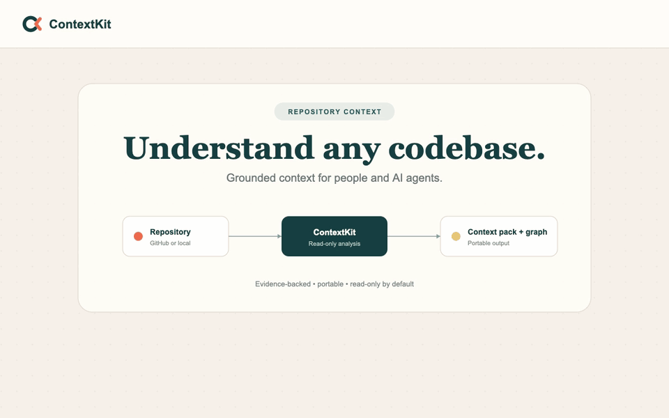
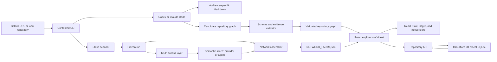
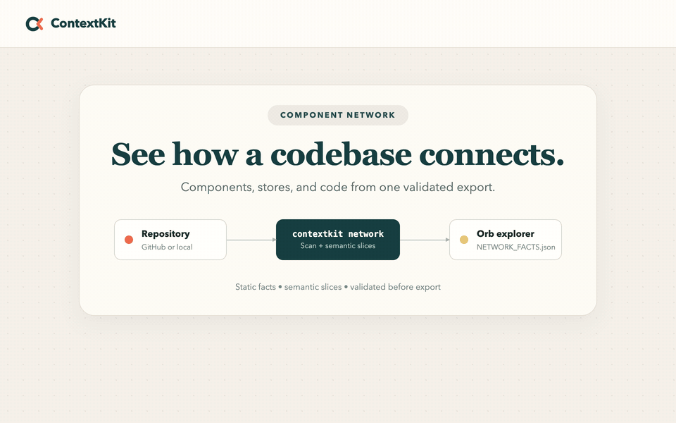

<p align="center">
  
</p>

<h1 align="center">ContextKit</h1>

<p align="center">
  Generate evidence-backed repository context packs and interactive architecture graphs for humans and AI agents.
</p>

<p align="center">
  <a href="LICENSE"></a>
  <a href="https://nodejs.org/"></a>
  <a href="#in-claude-code-or-codex"></a>
  <a href="#agent-skills"></a>
  <a href="https://github.com/nk-droid/contextkit/commits/main"></a>
</p>



## Why ContextKit?

Understanding an unfamiliar repository means piecing together information from source files, tests, configuration, scripts, CI workflows, and documentation. ContextKit turns that scattered knowledge into a structured context pack for onboarding, review, contribution, interview preparation, and AI-assisted development.

Unlike a generic repository summary, ContextKit produces audience-specific documents and a validated graph whose observed architecture claims cite repository-relative evidence paths.

## Architecture



The Bash CLI handles source resolution, temporary cloning, agent invocation, output selection, and file publishing. Codex or Claude Code inspects the target repository in read-only mode. Graphs are validated against the source repository before publication. The network pipeline is Node.js: a deterministic scanner freezes the repository into a run, a provider or the agent in your session interprets it through an MCP access layer, and the assembler validates the result before exporting it. The optional React explorer runs through Vinext, validates imported documents, stores them through a Cloudflare D1 binding, and renders them with React Flow and Dagre or as a network orb.

## Quick Start

### In Claude Code or Codex

Install ContextKit as a plugin; this repository is its own marketplace.

```bash
# Claude Code
claude plugin marketplace add nk-droid/contextkit
claude plugin install contextkit@contextkit

# Codex
codex plugin marketplace add nk-droid/contextkit
codex plugin add contextkit@contextkit
```

Then, in a new session inside any repository, ask for what you need: "write a reviewer guide for this repo", "build the repository graph", or "generate the component network". The skills are namespaced, for example `/contextkit:repo-context reviewer` in Claude Code. Documents go to `~/context-packs/<repo-name>/` unless you name a directory. Graph validation and the component network need Node.js `>=22.13.0`. [Agent Skills](#agent-skills) covers each skill and how updates work.

### From the command line

Requirements:

- Git and a Bash-compatible shell
- Node.js `>=22.13.0`
- Codex CLI or Claude Code, installed and signed in, for document generation and semantic network analysis
- Python 3 for Python symbol and call extraction (optional for other repositories)

```bash
git clone https://github.com/nk-droid/contextkit.git
cd contextkit
make install
export PATH="$PWD/bin:$PATH"

contextkit generate https://github.com/owner/repository --all --with-graph
contextkit network /path/to/repository
```

`generate` writes to `./context-packs/<repo-slug>/` relative to the directory where you run it. `network` needs no model account; see [Component Network](#component-network).

### View the results

From a checkout, `contextkit view` imports a `REPO_GRAPH.json`, a `NETWORK_FACTS.json`, or a directory holding them into the local explorer and opens it:

```bash
contextkit view ~/context-packs/<repo-name>/
```

It starts the explorer when none is running and stays in the foreground until Ctrl+C; when one is already running on the port, it imports and exits. The first run installs the explorer's dependencies, which takes about 20 seconds. Imports stay on this machine in `web/.wrangler/state/`. To run the explorer yourself instead, use `make web-install` and `make web-dev`, then import files from its pages.

## Example

Generate all documents and a repository graph with Codex:

```bash
contextkit generate https://github.com/owner/repository \
  --all \
  --with-graph
```

Use Claude Code with a larger turn budget:

```bash
contextkit generate /path/to/local/repository \
  --all \
  --with-graph \
  --agent claude \
  --max-turns 30
```

Choose a separate output directory:

```bash
contextkit generate /path/to/local/repository \
  --all \
  --with-graph \
  --output /path/to/output
```

Existing files are skipped by default. Add `--regenerate` to replace the selected outputs.

`--max-turns` applies only to Claude Code; `--model` can select a model for either agent.

## Generated Context

| Audience | Output | Focus |
|---|---|---|
| Human | `HUMAN_OVERVIEW.md` | Plain-English repository orientation |
| Architecture | `ARCHITECTURE.md` | Components, boundaries, flows, and trade-offs |
| Modules | `MODULE_GUIDE.md` | Important directories, files, and responsibilities |
| Reviewer | `REVIEWER_GUIDE.md` | Risk areas, checks, and validation strategy |
| Contributor | `CONTRIBUTOR_GUIDE.md` | Setup, reading order, and common workflows |
| Agent | `AGENT_CONTEXT.md` | Concise constraints and paths for AI systems |
| Interviewer | `INTERVIEWER_BRIEF.md` | Project narrative, decisions, and talking points |

A complete generation produces:

```text
context-packs/
  repo-slug/
    INDEX.md
    HUMAN_OVERVIEW.md
    ARCHITECTURE.md
    MODULE_GUIDE.md
    REVIEWER_GUIDE.md
    CONTRIBUTOR_GUIDE.md
    AGENT_CONTEXT.md
    INTERVIEWER_BRIEF.md
    REPO_GRAPH.json
```

Without `--all`, ContextKit generates the human overview by default. Select another audience with `--audience human`, `architecture`, `modules`, `reviewer`, `contributor`, `agent`, or `interviewer`.

## Agent Skills

The documents, graph, and component network are also agent skills, so Claude Code, Codex, and other agents that support skills can produce them inside a session.

| Skill | Produces |
|---|---|
| `repo-context` | Any of the audience documents above, or a full pack with `INDEX.md` |
| `repo-graph` | `REPO_GRAPH.json`, checked with the bundled validator before it is written |
| `repo-network` | `NETWORK_FACTS.json` for `/network`, through ContextKit's network pipeline: static, a headless provider, or the agent doing the semantic slices itself |

`repo-context` is self-contained, and `repo-graph` needs only Node.js for its validator. `repo-network` runs ContextKit's own commands, so it needs this repository's dependencies; when they are missing, its script prints the `npm ci` command to run.

Install the skills one way, not both, or every skill loads twice:

- **As a plugin** (see [Quick Start](#in-claude-code-or-codex)). `.claude-plugin/` holds the Claude Code marketplace and manifest, and `.agents/plugins/marketplace.json` and `.codex-plugin/plugin.json` hold the Codex ones. Both manifests load `.agents/skills/` in place. Skills are namespaced, as in `/contextkit:repo-context`. With the Claude Code plugin enabled, ContextKit's `bin/` commands are also on the PATH in sessions. Claude Code treats each commit as a new version: run `claude plugin update contextkit@contextkit`, or enable auto-update for the marketplace under `/plugin`. Codex caches the plugin by the version in `.codex-plugin/plugin.json`, which moves with `package.json`; refresh with `codex plugin marketplace upgrade`.
- **From a checkout.** The skills live in `.agents/skills/`, which Codex and most other agents read; `.claude/skills/` links to them for Claude Code, so they work as-is inside this checkout. `make install-skills` links them into `~/.claude/skills` and `~/.agents/skills` for every repository, without the prefix: `/repo-context reviewer` in Claude Code, `$repo-context` in Codex. The links follow the checkout, so `git pull` updates them.

Ask an agent for something like "a reviewer guide for this repo", or invoke a skill directly. Output goes to `~/context-packs/<repo-name>/` unless you name a directory.

The CLI reads the same files. `contextkit generate` sends `repo-context/references/standards.md` and the audience guide to the agent, and `--with-graph` sends `repo-graph/references/graph-rules.md`, so prompt changes go in the skills. `repo-graph` also carries copies of `scripts/validate-graph.mjs` and `schemas/repo-graph.schema.json`; `make sync-skills` refreshes them, and `make test` fails if they drift.

## Repository Graph

`--with-graph` generates a portable `REPO_GRAPH.json` document conforming to the versioned contract in `schemas/repo-graph.schema.json`.

The generator requests an architecture view and adds runtime-flow, import, or deployment views when useful. Nodes and edges distinguish directly observed behavior from inferred relationships. Every observed graph element must include at least one valid repository-relative evidence path. Each view is limited to 300 nodes and 1,000 edges.

Validate a graph without opening the UI:

```bash
node scripts/validate-graph.mjs \
  path/to/REPO_GRAPH.json \
  /path/to/repository
```

Open a graph with `contextkit view path/to/REPO_GRAPH.json`, which starts the explorer if needed. The React explorer supports:

- multiple repositories and graph views
- searchable nodes and paths
- node-kind and edge-kind filters
- inferred-relationship toggles
- isolated-node filtering
- evidence inspection
- runtime-flow step controls
- automatic horizontal and vertical layouts
- JSON file and directory imports

Imported graph documents and repository metadata are persisted through a Cloudflare D1 `DB` binding. Local development uses a SQLite-backed D1 database under `web/.wrangler/state/`; hosted deployments use Cloudflare D1. Imports with the same repository ID replace the stored graph document. No repository is seeded.

## Component Network



The demo opens AutoPR's network, built in agent mode with the `repo-network` skill, through `contextkit view`. It rotates the orb, filters it down to the architecture, inspects the Intake API, follows its connection to the job queue, searches, and zooms.

`bin/contextkit network` builds `NETWORK_FACTS.json`, the input to the explorer's `/network` page. It is a separate pipeline from `generate --with-graph`, which produces the Atlas's `REPO_GRAPH.json`: a deterministic scanner reads the repository, and Claude Code, Codex, or the agent in your session can add a semantic interpretation on top. How it works, what the export contains, and how it fails are in [docs/network.md](docs/network.md).

Install the runtime dependencies once (Node.js `>=22.13.0` and Git required):

```bash
cd /path/to/contextkit
npm ci --ignore-scripts

# Local Git checkout, including tracked working-tree changes
bin/contextkit network /path/to/repository

# Public Git clone URL; shallow-cloned into a temporary directory and cleaned up
bin/contextkit network https://github.com/owner/repository.git

# Choose the exported file's location
bin/contextkit network /path/to/repository --output /path/to/NETWORK_FACTS.json
```

The command prints the exact export and retained run paths. Open the export with
`contextkit view /path/to/NETWORK_FACTS.json`, or import it at `/network` after
`make web-install` and `make web-dev`. No model account is needed for the default static mode.
Components in this mode are explicitly **inferred directory groups**. Calls come
from the scanner; they can include heuristic resolutions and are not a complete
runtime call graph. Python extraction additionally requires Python 3.

For architecture components, external systems, stores, and data contracts, use
an installed, authenticated Claude Code or Codex CLI:

```bash
bin/contextkit network /path/to/repository --provider claude
bin/contextkit network https://github.com/owner/repository.git --provider codex

# Resume the frozen scan printed by a previous run without recloning/rescanning
bin/contextkit network /path/to/run-directory --provider claude

# Explicitly refresh the semantic interpretation
bin/contextkit network /path/to/run-directory --provider claude --regenerate

# Allow longer analysis for a larger repository (per slice)
bin/contextkit network /path/to/repository --provider claude --timeout-seconds 1800

# Export existing validated results without contacting a provider
bin/contextkit-export-network /path/to/run-directory \
  --provider claude --output /path/to/NETWORK_FACTS.json
```

The agent in your session can do the semantic analysis itself through the `repo-network` skill (`--provider agent`); see [agent mode](docs/network.md#agent-mode). Provider options, output locations, and failure modes are covered in [docs/network.md](docs/network.md).

The explorer's `/network` page draws a context facts document (the `ContextFactsDocument` contract in `schemas/context-facts.schema.json`) as one network: components, external systems, data stores, and, when symbol extraction ran, the classes and functions inside them. Declared relationships are drawn directly. Other links are derived from records that name several entities: data contracts, store access, API consumers, trust boundaries, shared risks and findings, dependencies, configuration keys, deployment targets, and claims.

Import a facts JSON file from the page's left panel. The browser keeps only the fields the network reads, and the API validates and stores that part in the same D1 database, keyed by repository ID. The page draws the network as a rotating 3D orb, with node-type and link-type filters, search, and a details panel with evidence links.

## Safety Model

- ContextKit does not need to be installed inside the target repository.
- Public GitHub repositories are shallow-cloned into a temporary workspace.
- Local repositories are inspected in place by read-only agent tools.
- Agent tools are restricted to repository reading and searching.
- Generated context goes under the invoking directory by default; run from outside the target repository or use `--output` to keep it external.
- Graph output is written to a temporary file and validated before an atomic replacement.
- Invalid regeneration preserves the previous graph and saves rejected output as `.REPO_GRAPH.invalid-output.txt` in the output directory.
- The CLI validator rejects evidence paths that escape the repository or do not exist there.
- The agent skills give an agent the same rules as instructions but cannot restrict its tools; prefer the CLI for unattended runs and repositories you do not trust.

Generated context is still a starting point for investigation, not a replacement for code review.

## Evaluation

ContextKit currently uses deterministic tests for the behavior it can verify automatically:

- schema conversion for Claude Code structured output
- successful graph generation and publication
- preservation of an existing graph after invalid regeneration
- surfaced agent error output
- structural graph validation
- unsafe and missing evidence-path rejection
- dangling-edge rejection
- observed-evidence enforcement
- duplicate-identifier rejection
- agent skill integrity and the CLI's use of the skill prompts
- the agent provider: prepared prompts, logged calls, evidence resolved across separate commands, rejected and valid submissions, and export
- `contextkit view` against a stand-in explorer: imports, page links, validation errors, and port detection

Run the automated CLI, scanner, provider, validation, and network checks:

```bash
make test
```

Validate the web application:

```bash
make web-build
```

Repository-scale evaluation should additionally record the pinned commit, source lines, tracked files, generation time, output size, graph nodes and edges, evidence references, unique evidence paths, and a manually audited evidence-accuracy sample. Performance numbers should only be published from repeatable measured runs.

## Architecture Decisions

- **Thin Bash orchestration:** keeps the CLI focused on source handling and agent execution rather than duplicating repository-analysis logic.
- **Prompts live in agent skills:** the CLI and interactive agents read the same audience guides and graph rules, so the two paths cannot drift apart.
- **Audience-specific documents:** produces focused context instead of one long summary that serves every reader poorly.
- **External output:** avoids modifying repositories that a user only wants to understand.
- **Versioned graph contract:** keeps generated JSON portable and independent from the renderer.
- **Observed versus inferred relationships:** makes uncertainty visible instead of presenting every model conclusion as fact.
- **Evidence-required graph elements:** connects architectural claims to files that a reviewer can inspect.
- **Atomic graph generation:** prevents malformed model output from replacing the last valid artifact.
- **SQLite-compatible persistence:** uses local SQLite during development and Cloudflare D1 when hosted.
- **Computed layouts:** stores repository meaning rather than UI coordinates, allowing the frontend to change layout direction and spacing.

## Limitations

- Repository understanding depends on what the selected agent discovers within its inspection budget.
- Very large repositories may require narrower runs or a larger Claude Code turn limit.
- ContextKit does not currently record the exact files opened by the generation agent.
- Markdown claims are not yet represented as individually machine-verifiable evidence records.
- The legacy Markdown/Atlas generator uses agent inspection; the network pipeline
  adds a deterministic static-analysis pass and validated semantic slices.
- Generated context can become stale after the source repository changes.
- The web importer checks graph structure and safe path syntax, but cannot verify evidence-file existence without the source repository.
- The web interface has no application-level authentication and should not be exposed publicly with private graph data.
- Codex or Claude Code must be installed and authenticated separately.

## Roadmap

- Publish reproducible benchmarks across repository sizes and languages.
- Add revision-aware stale-context detection and incremental regeneration.
- Record inspection telemetry and claim-level evidence coverage.
- Add optimized profiles for major frameworks and monorepos.
